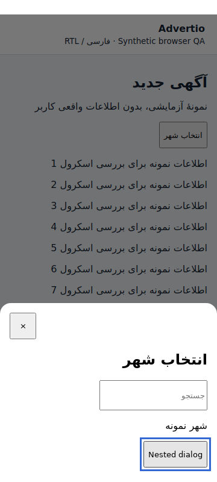
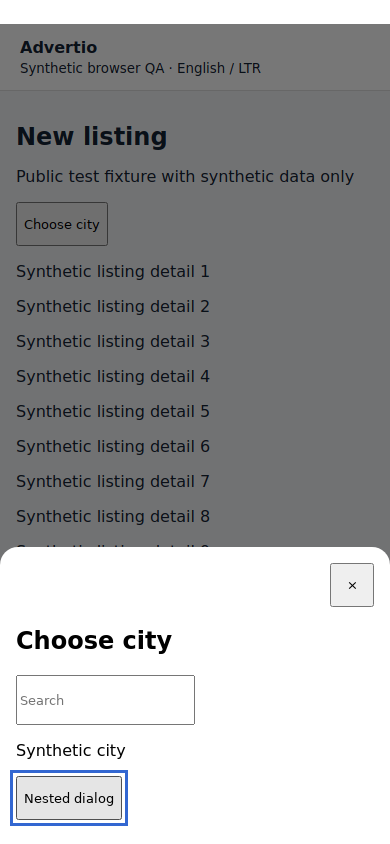
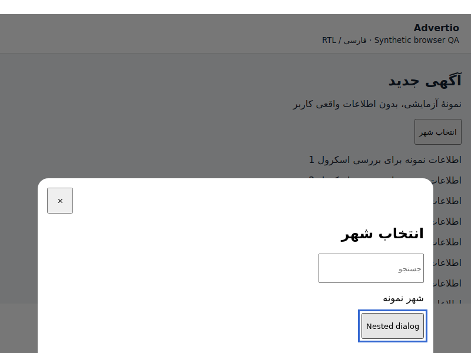

# Native navigation / keyboard / presentation (#48)

Android-only NativeUx plugin owns system-bar icon contrast, edge-to-edge WindowCompat and system/cutout/IME insets in CSS pixels. It does not assume setOverlaysWebView(false) disables Android 16 edge-to-edge. Android CSS uses logical layout, safe-area padding, a keyboard-aware visible height, scroll margins, 44px controls, focus outlines and reduced-motion support. OS/user theme changes update native status/navigation icon contrast.

Hardware Back: hide IME, close the top registered sheet/page callback, use router history, then native Stay/Leave confirmation at root. Leave minimizes rather than destroys the process. Native dialog cancellation is explicit; multiple Back events cannot open multiple confirmations. The Android Sheet replacement registers a scoped Back callback, traps focus, restores the previous focus and handles only the topmost Escape. It supports RTL/LTR without changing browser/Telegram source.

The adapter keeps bounded in-memory per-route scroll positions for marked/known scroll containers, restores on history/popstate and leaves form/auth data to their existing stores. Unmarked custom scroll containers and process-death draft restoration require real UI verification; no claim that all upstream tabs/forms were exercised. Keyboard height is not subtracted twice if WebView/visual viewport already resized. Insets and landscape behavior still require device validation.

Entrypoint waits for #47 payment/native navigation policy and NativeUx before React import; fixed error + Retry replaces an unsafe partial startup. Offline status is visible without logging requests or credentials. No production private UI is bundled in this public folder.

## Synthetic visual QA

Public fixture uses the actual original Android Sheet/CSS/controller, real React, and mocked native services. It contains no private source or user data. Three target viewports: 360×800 Persian RTL, 390×844 English LTR, 800×600 Persian landscape. These screenshots prove browser presentation of the fixture only, not Android/emulator/private-app acceptance.

Commands (from repo root):
```bash
npm ci --prefix android/tests/harness --ignore-scripts
node android/tests/harness/build-fixture.mjs
# With Playwright and Chromium installed:
node android/tests/navigation/visual-check.mjs
node --test android/tests/navigation/*.test.mjs
```

ADVERTIO_PLAYWRIGHT_MODULE can point at an installed Playwright module; ADVERTIO_CHROMIUM_PATH selects a browser executable. The fixture is injected directly into the browser and requires no local web server. Dependencies for the fixture are locked in tests/harness. Snapshot output lives under tests/navigation/snapshots and must be labeled synthetic.

Device QA NOT RUN: API24/Android13–16, gesture/3-button nav, native exit dialog, real IME/rotation, accessibility text sizes and full private UI network/modal flows. Foundation #41 SDK/JDK/device, authorized private build and #63 CORS remain blockers. Snapshot results and exact automated checks are recorded in the PR after execution; no device screenshots are fabricated. Refs #48 until real acceptance passes. Rollback: revert native UX module/CSS/hooks/fragment and rebuild reviewed pins.

## Executed worker evidence — 2026-10-22

PASS: actual Sheet/CSS/controller synthetic browser fixture in 360×800 RTL, 390×844 LTR, 800×600 RTL; nested Escape closes only the top dialog, mocked hardware Back closes the remaining sheet, no horizontal overflow, and focused input remains in the simulated keyboard-visible area. Browser: headless Chromium 133 with Playwright client. These are public fixture screenshots, not an emulator or the private application.





Current foundation + #45/#47/#48 (Google #46 deferred): 21 Node unit tests and 12 Python tests PASS; public-overlay typecheck with synthetic application contracts PASS; fixture bundling PASS; scope/diff and 33 combined payload hashes PASS. Three browser viewports additionally verify the disabled Google container/button and absence of its provider script. Real native/Play acceptance remains NOT RUN as above. See [current-version.md](current-version.md).
