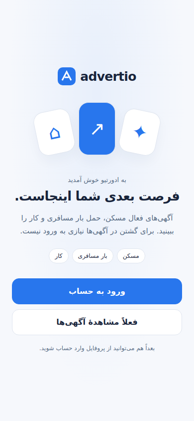
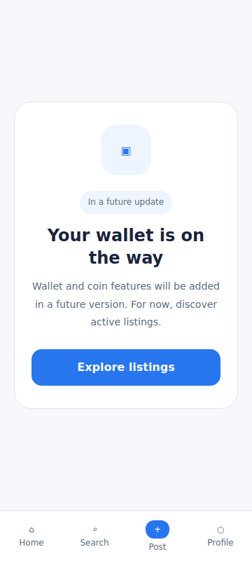

# Android welcome, guest browsing and future wallet

Owner request, 2026-10-23. Refs #45, #47, #48 and parent #38.

First launch presents Welcome with Sign in and Browse listings for now. Sign in uses the existing LoginScreen and OTP/Telegram hooks; Google remains disabled. Back returns to Welcome. Browsing continues to the existing public home/listing routes, with login available later from Profile. Completion stores only `advertio.android.welcome.v1=seen`; no token, identity or verified-phone state is created. Missing/blocked localStorage does not prevent browsing. An authenticated restored session dismisses Welcome automatically. Existing PhoneGate and payment restrictions remain authoritative.

The footer has Home, Search, Post and Profile, using four equal columns. Wallet is absent. Direct `/wallet` displays a static future-version card and an Explore listings action. It imports no balance, payment, transaction or history queries. Existing payment/provider/API restrictions remain enabled. This supersedes the earlier visible read-only wallet scope in payment-policy.md. Profile links or guarded purchase-route redirects that reach `/wallet` show this same future card.

Original Android glue replaces App and TabBar only in the external build workspace. The hash-bound `manifests/welcome.json` explicitly supersedes the previous WalletPage payload. Public Git contains no private application source, account data, uploaded screenshot or compiled private bundle. New local build locks must include the App/TabBar target hashes and ABSENT pins for the new onboarding files, reviewed against the pinned private snapshot. Development version metadata is now versionCode 2 / versionName 1.0.1-debug; this does not mean a new APK has been built.

Verification executed:

- PASS: 27 Node tests (including presentation-only guest completion and unavailable storage), 14 Python tests, overlay contract typecheck, all 43 combined payload hashes, diff and Android scope checks.
- PASS: actual public App/Welcome/TabBar/Wallet overlays bundled with synthetic router/auth/native contracts. Chromium 133 checks 360×800 English light, 390×844 Persian RTL light, 800×600 English dark. Welcome, optional login, mocked hardware Back, guest status, persisted completion/relaunch, later Profile login, four footer items without Wallet, future card, no API calls, return to listings, synthetic successful login and no page errors/overflow all pass.
- PASS: existing three-viewport Sheet/keyboard/Back fixture regression; Google remains hidden without provider script.
- Screenshots below are synthetic browser fixtures. Listing screens, login completion, icons and logo are test substitutes, not private-app/device evidence.
- NOT RUN for this revision: full private application compile, Capacitor sync, Gradle assembleDebug, new APK signature verification, real OTP/API/device acceptance. The earlier APK from PR #74 predates these changes.

The previous private dependency install was blocked by automatic approval review because it would contact public npm using a private source lockfile and could disclose dependency names/versions. No retry using that private dependency metadata was made. Owner approval for that disclosure is needed to produce the updated private APK. Public test-harness dependencies were installed independently using only the checked-in public manifest.

Reproduce from repository root:

```bash
npm ci --prefix android/tests/harness --ignore-scripts
node android/tests/harness/typecheck.mjs
node --test android/tests/*/*.test.mjs
python3 -m unittest discover -s android/tests/source -p 'test_*.py'
python3 -m unittest discover -s android/tests/pipeline -p 'test_*.py'
python3 -m unittest discover -s android/tests/auth -p 'test_*.py'
node android/tests/harness/build-entry-fixture.mjs
# Set ADVERTIO_PLAYWRIGHT_MODULE / ADVERTIO_CHROMIUM_PATH to installed tools as needed.
node android/tests/navigation/entry-visual-check.mjs
bash android/scripts/guard-scope.sh origin/main
```




Rollback: revert this change and rebuild from reviewed private pins. Previously installed APKs are unaffected until a new build is installed. Release/Play acceptance remains open; do not close the referenced issues from synthetic checks.
